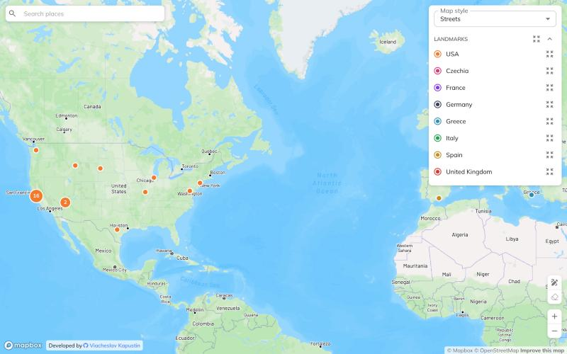
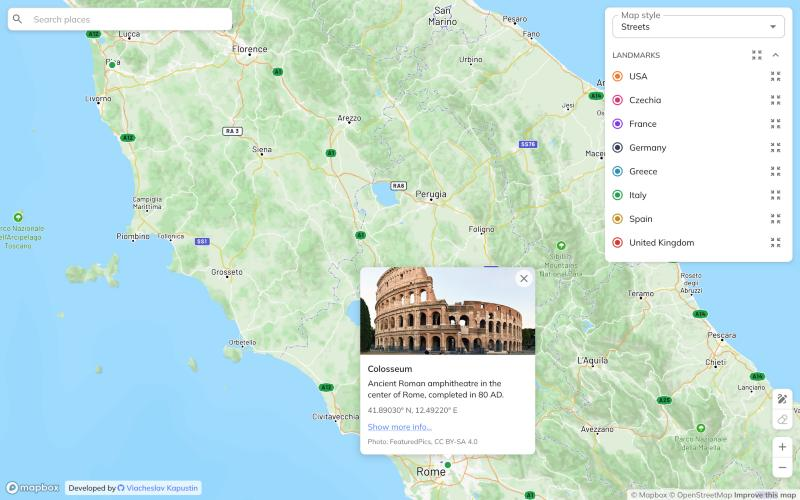
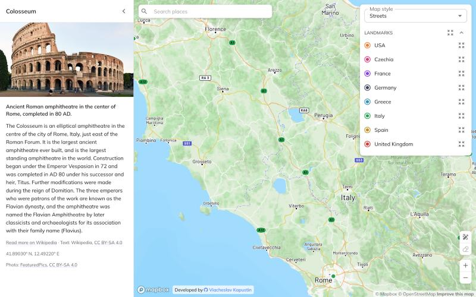
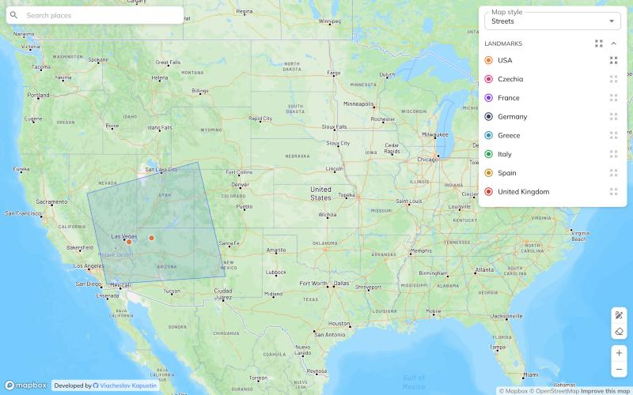
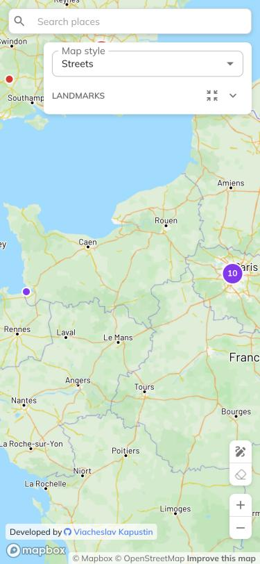

# Mapbox Interactive

An interactive map of landmarks in the USA and Europe, built with Next.js and
OpenLayers on Mapbox basemaps. The Mapbox access token never reaches the
browser: every Mapbox request goes through this app's server.

Developed by [Viacheslav Kapustin](https://github.com/VKapustin/).



## Features

- **Mapbox basemaps without exposing the token.** Vector styles (Streets,
  Outdoors, Light, Dark, Satellite) are rendered by OpenLayers through
  `ol-mapbox-style`. Styles, tiles, sprites and fonts load through a server
  proxy that adds the token and only allows read-only Mapbox endpoints. The
  style picker shows a thumbnail of each style.
- **Landmark layers by country.** One layer per country (USA, Czechia, France,
  Germany, Greece, Italy, Spain, United Kingdom), each in its own color. The
  map opens fitted to all visible layers.
- **Server-side clustering.** Landmarks are clustered on the server with
  `supercluster` and loaded tile by tile. Clicking a cluster zooms in to where
  it splits.
- **Landmark details.** Clicking a landmark opens a popup with a photo, a short
  description and its coordinates. "Show more info…" opens a side drawer with
  the Wikipedia summary, loaded through the server.
- **Landmarks panel.**
  - Show or hide each country; the checkbox is a circle in the layer's color,
    so it doubles as the legend.
  - Zoom to one country, or show and zoom to all of them.
  - Collapse the list; the browser remembers whether it was open.
  - The panel never grows past the drawing tools; the list scrolls instead.
- **Place search.** Mapbox Search Box suggestions (through the proxy), biased
  toward the map's center. Choosing one adds a marker and zooms to it.
- **Area of interest (AOI).**
  - Draw a polygon (click to add corners, double-click or click the first
    corner to finish, Escape to cancel), and clear it with the eraser.
  - Only landmarks inside the area are shown. The server filters them, so
    cluster counts include only what's inside.
  - Countries with nothing inside can't be zoomed to, and the panel says so
    when the area holds no landmarks at all.
- **Responsive layout.** On a narrow map (a phone, or a desktop with the details
  drawer open) the search box and the panel stack instead of overlapping.
  Light and dark themes follow the system setting.

## Screenshots

**A landmark's popup:** photo, description, coordinates and photo credit.



**The details drawer:** the Wikipedia summary, with its credit, beside the map.



**Filtering by a drawn area:** only the landmarks inside it stay on the map,
and countries with none inside can't be zoomed to.



**On a phone:** the search box and the panel stack, here with the landmark list
collapsed.



## Getting started

Requirements: Node.js 20.9 or later, and a [Mapbox access token](https://account.mapbox.com/access-tokens/).

1. Install dependencies:

   ```bash
   npm install
   ```

2. Copy the environment template and set your token in `.env.local`:

   ```bash
   cp .env.example .env.local
   ```

   ```bash
   MAPBOX_TOKEN=pk.your-token-here
   ```

   Keep the token server-only: don't rename it to `NEXT_PUBLIC_…`, or Next.js
   would ship it to the browser.

3. Start the development server and open [http://localhost:3000](http://localhost:3000):

   ```bash
   npm run dev
   ```

### Environment variables

| Variable | Required | Purpose |
|---|---|---|
| `MAPBOX_TOKEN` | Yes | Mapbox access token, used only by the server proxy. |
| `WIKIMEDIA_USER_AGENT` | No | User-Agent for Wikipedia requests. Wikimedia asks for contact details, e.g. `mapbox-interactive/0.1 (https://example.com; you@example.com)`. |

### Browser support

Safari 16+ (iOS 16+), Chrome and Edge 105+, Firefox 110+. The layout of the
controls over the map uses CSS container queries, and the browser's requests to
this app's API use `AbortSignal.timeout`; older browsers lack both, so the
search box and the panel overlap, and the landmarks, search, the details drawer
and area filtering don't load.

## Scripts

| Command | What it does |
|---|---|
| `npm run dev` | Development server with hot reload |
| `npm run build` | Production build |
| `npm start` | Serve the production build |
| `npm run lint` | ESLint |
| `npm test` | Vitest in watch mode |
| `npm run test:run` | Vitest once (CI) |

## Server API

All routes are Next.js route handlers in `src/app/api/`.

| Route | Purpose |
|---|---|
| `GET /api/mapbox/[...path]` | Proxy to `api.mapbox.com` that adds the token. Allows styles, tiles, fonts and Search Box forward only, and only for same-origin requests. |
| `GET /api/map/config` | Map configuration: view, styles with thumbnails, layers with their extents. |
| `GET /api/map/layers/[id]` | A layer's features as GeoJSON. |
| `GET /api/map/layers/[id]/clusters/[z]/[x]/[y]` | One map tile of a layer's clusters and single points. |
| `GET /api/map/aoi/summary?aoi=` | For an area of interest: each layer's count inside it, its total, and the extent of the landmarks inside. |
| `GET /api/wikipedia/summary/[title]` | Wikipedia article summary. Only serves articles the map data links to. |

The layer and cluster routes also take `?aoi=` (a GeoJSON Polygon geometry in
longitude/latitude) and then return only what's inside it. An invalid area is
rejected with `400`.

## Project structure

```
src/
  app/            Pages and API route handlers
  components/     UI components; styles in styles/*.styles.tsx next to each
  hooks/          React hooks, by area: map, draw, storage, string, wikipedia
  helpers/        Shared helpers (map setup, AOI parsing and point-in-polygon)
  server/         Server-only code: map config, landmark data, clustering,
                  UI strings, Wikipedia
  udl/            The browser's requests to this app's API (timeouts, retries)
  constant/       Shared constants
  theme/          MUI theme (light and dark)
  types/          Shared TypeScript types
public/landmarks/ Landmark photos, one folder per layer
docs/screenshots/ The screenshots in this README
deploy/           systemd service and nginx site for a VPS (see "Deploying to a VPS")
assets/icon/      Icon drawings; `node assets/icon/build-icons.mjs` rebuilds
                  src/app/favicon.ico and src/app/apple-icon.png
tests/            Vitest tests, mirroring src/
  support/        Shared test code (setup, fixtures, render helpers); no src/ counterpart
```

## Adding a landmark layer

1. Add a GeoJSON file in `src/server/map/data/`. Each feature is a point with
   `name`, `description`, `wikipediaTitle` and `image` (`url`, `author`,
   `license`, `licenseUrl`, `sourceUrl`).
2. Put its photos in `public/landmarks/<layer id>/`.
3. Register the file in `src/server/map/mapLayers.ts`, and add the layer, with
   its color, in `src/server/map/mapConfig.ts`.
4. Add its bounding box to `LAYER_BOUNDS` in `tests/server/map/mapLayers.test.ts`.
   The tests check every data file, photo and license.

UI text lives in `src/server/strings/strings.ts`, not in the components.

## Keeping the data in a database

The landmark data is JSON files bundled with the app, which suits a small,
fixed dataset. To edit landmarks without a deploy, or to hold many more, they
can move to a database (e.g. PostgreSQL with PostGIS, or MongoDB) or a CMS. The
browser and the API routes don't need to change: all server code reads the data
through a few functions.

- **Data:** `getMapLayerData(id)` and `getMapLayerIds()` in
  `src/server/map/mapLayers.ts`. Load each layer from the database here, and
  keep returning a GeoJSON FeatureCollection.
- **Layer list:** `getMapConfig()` in `src/server/map/mapConfig.ts` lists the
  layers, with their labels and colors. That list can come from a table too.
- **Caches:** `src/server/map/clusters.ts` builds each layer's cluster index once
  and keeps it for the life of the server process, because the bundled data only
  changes with a deploy. Once the data can change while the app runs, clear or
  rebuild a layer's index when it changes (or give it a time limit). Indexes for
  areas of interest are already kept only for the most recently used areas.
- **AOI filtering (optional):** a spatial database can select the points inside
  an area itself (PostGIS `ST_Within`), so only those reach the server. Filter
  in Web Mercator, the projection the area is drawn in, as `isInAoi` in
  `src/helpers/aoiHelpers.ts` does.
- **Photos:** they're served from `public/landmarks/`. With a database, store
  them in object storage (or keep Wikimedia Commons URLs) and save each photo's
  URL and credit with its landmark.
- **Tests:** `tests/server/map/mapLayers.test.ts` checks the bundled JSON files
  and photos. With a database, run those checks when data is saved instead (or
  against a test database).

## Testing

```bash
npm run test:run
```

Vitest with jsdom and React Testing Library covers the components, hooks,
helpers, server code and API routes. Layout (sizes, scrolling, stacking) can't
be measured in jsdom, so check it in a browser.

## Deploying to a VPS

The app needs a Node.js server; static hosting can't run its API routes. On a
VPS, run the production build as a systemd service on localhost, with nginx in
front for HTTPS, rate limiting and caching. Ready-made files are in `deploy/`:

- `deploy/mapbox-interactive.service`: the systemd service.
- `deploy/nginx.conf.example`: the nginx site.

**Before going public**, protect your Mapbox account: every visitor's map uses
your token through the proxy.

- **Set a usage alert, or a cap,** in your Mapbox account.
- **Give the token only the public read scopes** the app uses (styles, tiles,
  fonts, Search).
- **Rotate the token** if it ever leaks.
- **A URL restriction won't work:** it checks the `Referer` header, and requests
  from the server don't send one.

### Setup

Setup on Ubuntu or Debian, as a user with `sudo`:

1. **Install Node.js 20.9 or later, nginx and certbot.**

   ```bash
   sudo apt install nginx certbot python3-certbot-nginx
   ```

2. **Create a user for the app, clone and build it.**

   ```bash
   sudo useradd --system --create-home --shell /usr/sbin/nologin mapbox
   sudo install -d -o mapbox -g mapbox /srv/mapbox-interactive
   sudo -u mapbox git clone <repository URL> /srv/mapbox-interactive
   cd /srv/mapbox-interactive
   sudo -u mapbox npm ci
   ```

   Set `MAPBOX_TOKEN` and `WIKIMEDIA_USER_AGENT` in
   `/srv/mapbox-interactive/.env.local`. `next start` reads that file. Make it
   readable by the app's user only:

   ```bash
   sudo -u mapbox cp .env.example .env.local
   sudo -u mapbox chmod 600 .env.local
   ```

   After editing `.env.local`, build:

   ```bash
   sudo -u mapbox npm run build
   ```

3. **Start the service.** It listens on `127.0.0.1:3000` only, so requests
   can't bypass nginx. Check the path to `node` in `ExecStart` against
   `which node` first.

   ```bash
   sudo cp deploy/mapbox-interactive.service /etc/systemd/system/
   sudo systemctl daemon-reload
   sudo systemctl enable --now mapbox-interactive
   ```

   The service runs `next start` itself, so don't run `npm run start` by hand.
   `--now` starts the app right away and `enable` starts it on every boot;
   systemd also restarts it if it crashes. Check that it's running (look for
   `active (running)` and `✓ Ready`) and that it answers:

   ```bash
   sudo systemctl status mapbox-interactive
   ```

   ```bash
   curl -I http://127.0.0.1:3000
   ```

   Logs: `journalctl -u mapbox-interactive -f`.

4. **Get a certificate.** Point the domain's DNS at the server first. Do this
   before installing the site, which refers to the certificate files. Certbot
   renews the certificate on its own.

   ```bash
   sudo certbot certonly --nginx -d example.com
   ```

5. **Install the nginx site.** Replace `example.com` with your domain in
   `/etc/nginx/conf.d/mapbox-interactive.conf`, then test and reload:

   ```bash
   sudo cp deploy/nginx.conf.example /etc/nginx/conf.d/mapbox-interactive.conf
   ```

   Create the folder for the Mapbox cache. nginx creates only its last level,
   and `/var/cache/nginx` doesn't exist on Ubuntu or Debian. The owner is the
   user nginx's workers run as: `www-data` on Ubuntu and Debian, `nginx` on
   RHEL and Fedora.

   ```bash
   sudo install -d -o www-data -g www-data -m 700 /var/cache/nginx/mapbox
   ```

   ```bash
   sudo nginx -t && sudo systemctl reload nginx
   ```

### What the nginx site does

- **Rate limits per client IP.**
  - Tiles, styles and fonts: 10 requests/s with bursts of 300, because panning
    loads many tiles at once.
  - Search: 2 requests/s with bursts of 10, since every keystroke is a paid
    Mapbox request.
  - The app's own API: 20 requests/s with bursts of 400.
  - Over the limit, nginx answers `429` with `Retry-After`. Watch `error.log`
    for "limiting requests" and adjust the numbers.
  - Behind Cloudflare or another proxy, configure `set_real_ip_from` first, or
    every client shares one limit.
- **Caches Mapbox responses** (not search) on disk, following their
  `Cache-Control`.
  - Repeated tiles cost no Mapbox quota. The `X-Cache-Status` response header
    shows hits.
  - Cached responses are served without reaching the app, so its same-origin
    check doesn't apply to them.
  - Check that Mapbox's terms allow server-side caching on your plan. If not,
    remove the `proxy_cache*` lines.
- **Allows long URLs** (`large_client_header_buffers 4 16k`). A detailed area of
  interest travels in the URL, and nginx's default limit would answer `414`.
- **Passes the public `Host` header** to the app, which the Mapbox proxy's
  same-origin check needs.
- **Adds security headers:** HSTS, `nosniff`, `Referrer-Policy` and
  `X-Frame-Options`. There's no Content-Security-Policy yet.

### Updating

The landmark data is part of the build, so data changes need a rebuild too:

```bash
cd /srv/mapbox-interactive
```

```bash
sudo -u mapbox git pull
```

```bash
sudo -u mapbox npm ci
```

```bash
sudo -u mapbox npm run build
```

```bash
sudo systemctl restart mapbox-interactive
```

The app is one Node.js process, so its in-memory caches (cluster indexes, area
results, the Wikipedia allowlist) are shared by all visitors. They're rebuilt
after each restart.

### Logs

**The app.** systemd collects what the app prints: startup (`✓ Ready`),
crashes and restarts, and server errors such as a failed Mapbox or Wikipedia
request. Next.js doesn't log each request in production; nginx does.

```bash
journalctl -u mapbox-interactive -f
```

Ctrl+C stops following. Instead of `-f`: `-n 100` for the last 100 lines,
`--since "1 hour ago"` for a period of time, `-p err` for errors only.

**nginx.** Every request goes to `/var/log/nginx/access.log` (IP, time, URL,
status, size), and nginx's own problems to `/var/log/nginx/error.log`.

```bash
sudo tail -f /var/log/nginx/access.log
```

Failed requests only (status 4xx or 5xx):

```bash
sudo awk '$9 >= 400' /var/log/nginx/access.log | tail -50
```

Clients that hit the rate limits. Each line names the zone (`mapbox`, `search`
or `api`) and the IP. A few are normal; if ordinary visitors show up often,
raise that zone's `burst`.

```bash
sudo grep "limiting requests" /var/log/nginx/error.log | tail -20
```

`502 Bad Gateway`, with "Connection refused" in `error.log`, means the app
isn't running: check `systemctl status mapbox-interactive` and its journal.

**The Mapbox cache.** Responses from `/api/mapbox/` carry `X-Cache-Status`. Ask
for the same tile twice: the first says `MISS`, the second `HIT`.
(`Sec-Fetch-Site` passes the app's same-origin check, as a browser does.)

```bash
curl -sI -H "Sec-Fetch-Site: same-origin" https://example.com/api/mapbox/v4/mapbox.mapbox-streets-v8/1/0/0.vector.pbf | grep -i x-cache
```

**Disk space.** The journal has a size limit, and logrotate keeps nginx's logs
for about two weeks, compressing older ones (`access.log.2.gz`); read those
with `sudo zcat`.

## Credits

- Map data and styles © [Mapbox](https://www.mapbox.com/about/maps/) and
  © [OpenStreetMap](https://www.openstreetmap.org/copyright) contributors.
- Landmark photos are from [Wikimedia Commons](https://commons.wikimedia.org/).
  Each photo's author and license (Creative Commons, public domain or the Free
  Art License) are in the layer data and shown with the photo.
- Landmark summaries come from [Wikipedia](https://www.wikipedia.org/), loaded
  live and credited in the drawer with the landmark's details.

## License

The code is released under the [MIT License](LICENSE), © 2026 Viacheslav
Kapustin. That covers this repository's own work: the source code, tests,
landmark data and descriptions, the app icon drawings (`assets/icon/`) and
screenshots.

It doesn't cover third-party material, which keeps its own terms:

- **Landmark photos** (`public/landmarks/`): Wikimedia Commons images under
  Creative Commons, public domain or the Free Art License. Each photo's author,
  license and source page are in the layer data (`src/server/map/data/`) and
  shown with the photo; reusing a photo means following its license.
- **Mapbox logo** (`public/mapbox-logo.svg`): a Mapbox trademark, shown here as
  Mapbox's terms require. Map data and styles are © Mapbox and © OpenStreetMap
  contributors, and need your own Mapbox account and token.
- **The eraser icon** (`src/components/icons/EraserIcon.tsx`) is
  [Lucide's eraser](https://lucide.dev/icons/eraser), under the ISC License,
  whose notice is kept in that file.
- **Wikipedia summaries** aren't stored in the repository; they're loaded live
  under CC BY-SA 4.0 and credited where shown.
- **Dependencies** in `package.json` (Next.js, MUI, OpenLayers and others) and
  the Mulish font (SIL Open Font License, loaded by `next/font`) have their own
  licenses.
